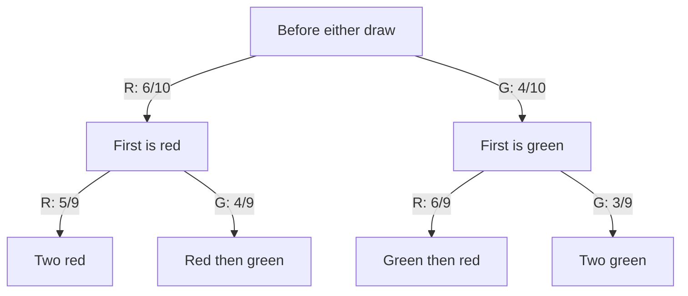

# Probability Trees

A probability tree represents an experiment through successive cases. Each branch probability is conditional on the history at its starting node. Multiplying along a path gives a joint probability, and adding complete, disjoint paths gives an event probability. The tree therefore records both which outcomes are possible and which information each probability conditions on.

## Structure of Probability Trees

A probability tree starts with a root node that branches out into possible outcomes of the first event. Each of these outcomes becomes a node that branches into further outcomes, continuing for as many events as are being considered. The branches are labeled with probabilities, and the path to each outcome shows the sequence of events leading to that outcome.

## Rules for Probability Trees

1. The sum of the probabilities of all branches from a single node must equal 1, as they represent all possible outcomes of that event.
2. The probability of an event or sequence of events represented by a path is found by multiplying the probabilities along the path.
3. The probability of an event that can occur in multiple ways is the sum of the probabilities of all paths leading to that event.

For three stages, the path rule is the chain rule $P(A\cap B\cap C)=P(A)P(B\mid A)P(C\mid A\cap B)$, when these conditionals are defined. Multiplication does not require independence. Independence only permits replacing the conditional branch probabilities with the same unconditional probabilities at every relevant node. Add terminal paths, rather than a parent and one of its descendants, because those would overlap.

## Example: Drawing Cards

Consider a simplified example where we draw one card from a standard deck of 52 cards, and we're interested in the event of drawing a heart or not drawing a heart. The event space for this problem can be represented using a probability tree, which helps visualize the possible outcomes and their associated probabilities.

| First-draw case | Number of cards | Branch probability |
|---|---|---|
| Heart | 13 | $13/52=1/4$ |
| Not Heart | 39 | $39/52=3/4$ |

Both branches leave the same initial state and exhaust the possibilities. This table records the one-stage tree without requiring a separate drawing.

Here is a step-by-step explanation of the tree:

- The initial node represents the state before any card is drawn.
- From the initial node, there are two possible outcomes: drawing a heart or not drawing a heart.
- The probability of drawing a heart is determined by the number of hearts in the deck (13) divided by the total number of cards (52). Thus, the probability of drawing a heart is:

$$
P(\text{Heart}) = \frac{13}{52} = \frac{1}{4}
$$

- The probability of not drawing a heart is simply the complement of the probability of drawing a heart. Since there are 39 cards that are not hearts in a standard deck of 52 cards, the probability of not drawing a heart is:

$$
P(\text{Not Heart}) = \frac{39}{52} = \frac{3}{4}
$$

This structure is consistent with the principle that the total probability of all possible outcomes must sum to 1, i.e.:

$$
P(\text{Heart}) + P(\text{Not Heart}) = 1
$$

$$
\frac{1}{4} + \frac{3}{4} = 1
$$

Thus, the probability tree correctly reflects the outcomes and their associated probabilities.

## Example: Tossing a Coin and Rolling a Die

In this example, we examine two independent events: first, tossing a coin, and then rolling a die. The probability tree for this scenario helps to visualize the sequential outcomes and probabilities at each stage of the experiment.

| Coin branch | Possible die branches | Conditional probability per die face | Joint probability per path |
|---|---|---|---|
| Head, probability $1/2$ | $1,2,3,4,5,6$ | $1/6$ given Head | $1/12$ |
| Tail, probability $1/2$ | $1,2,3,4,5,6$ | $1/6$ given Tail | $1/12$ |

Each row represents six distinct terminal paths. The die probabilities are identical after either coin outcome because the model assumes independence.

### Interpreting the Probability Tree

I. **Initial Node (Coin Toss)**: The experiment begins with a coin toss. The initial node represents the state before any action is taken.

II. **First Level Branches (Coin Toss)**:  

- The first branching represents the two possible outcomes of tossing a fair coin: "Head" and "Tail."  
- The probability of getting a "Head" is:

$$
P(\text{Head}) = \frac{1}{2}
$$

Similarly, the probability of getting a "Tail" is:

$$
P(\text{Tail}) = \frac{1}{2}
$$

These probabilities reflect the equal likelihood of both outcomes for a fair coin.

III. **Second Level Branches (Die Roll)**:  

- After the coin toss, we roll a fair six-sided die.  
- Each outcome of the die roll (the numbers 1 through 6) is represented by the second level of branches.  
- The probability of rolling any specific number on the die (e.g., rolling a 1, 2, or 6) is:

$$
P(\text{Die Roll}) = \frac{1}{6}
$$

since each face of the die is equally likely to appear.

### Calculating Probabilities of Combined Events

The probability of any combined outcome (e.g., tossing a "Head" followed by rolling a "4") is calculated by multiplying the probabilities of the individual events along the relevant path in the tree. For example:

$$
P(\text{Head and 4}) = P(\text{Head}) \times P(4) = \frac{1}{2} \times \frac{1}{6} = \frac{1}{12}
$$

Similarly, the probability of getting a "Tail" followed by rolling a "2" would be:

$$
P(\text{Tail and 2}) = P(\text{Tail}) \times P(2) = \frac{1}{2} \times \frac{1}{6} = \frac{1}{12}
$$

### General Form

The total probability for any combined event is always the product of the individual probabilities along its branch. Since the events are independent, the combined probability of any outcome from the coin toss followed by a die roll is given by:

$$
P(\text{Combined Event}) = P(\text{Coin Outcome}) \times P(\text{Die Outcome})
$$

The probability tree can be used to calculate all possible combinations of outcomes, and since there are 12 possible combinations (2 coin outcomes × 6 die outcomes), the total probabilities sum to 1. This ensures that the model accounts for all potential outcomes:

$$
\sum P(\text{Outcome}) = 1
$$

## Example: Rolling Two Dice

In this example, we explore the scenario of rolling two six-sided dice simultaneously. A probability tree provides a clear visualization of all possible outcomes and their associated probabilities.

| First die branch | Second die branches after that result | Probability of each complete path |
|---|---|---|
| 1, probability $1/6$ | $1,2,3,4,5,6$, each $1/6$ | $1/36$ |
| 2, probability $1/6$ | $1,2,3,4,5,6$, each $1/6$ | $1/36$ |
| 3, probability $1/6$ | $1,2,3,4,5,6$, each $1/6$ | $1/36$ |
| 4, probability $1/6$ | $1,2,3,4,5,6$, each $1/6$ | $1/36$ |
| 5, probability $1/6$ | $1,2,3,4,5,6$, each $1/6$ | $1/36$ |
| 6, probability $1/6$ | $1,2,3,4,5,6$, each $1/6$ | $1/36$ |

The six rows each contain six terminal cases, giving all 36 ordered outcomes. A tree is a factorization of their joint probabilities; drawing its branches in a sequence does not require the physical dice to be rolled at different times.

### Interpreting the Probability Tree

I. **Initial Node (Before Rolling Dice)**: The initial node represents the state before any dice are rolled.

II. **First Level Branches (First Die Roll)**:  

- Each branch from the initial node corresponds to one of the six possible outcomes from rolling the first die, which are the numbers 1 through 6.
- Since the die is fair, the probability of any outcome on the first die is:

$$
P(\text{First Die Outcome}) = \frac{1}{6}
$$

III. **Second Level Branches (Second Die Roll)**:  

- After rolling the first die, for each outcome, there are six branches representing the possible outcomes of rolling the second die.
- Each outcome on the second die (also numbered 1 through 6) has an equal probability of occurring, independent of the first die's outcome:

$$
P(\text{Second Die Outcome}) = \frac{1}{6}
$$

### Calculating Probabilities of Combined Events

To compute the probability of rolling a specific combination (e.g., rolling a "3" on the first die and a "5" on the second), we multiply the probabilities along the path that represents the combined event. For example:

$$
P(3 \text{ on first die and } 5 \text{ on second die}) = P(3) \times P(5) = \frac{1}{6} \times \frac{1}{6} = \frac{1}{36}
$$

Since the outcomes of the two dice are independent, the probability of any specific combination is always the product of the probabilities of the individual outcomes.

### Total Number of Outcomes

There are 36 possible combinations of outcomes (6 outcomes from the first die × 6 outcomes from the second die). Each combination has an equal probability of occurring:

$$
P(\text{Any Specific Combination}) = \frac{1}{36}
$$

### General Form

The probability of rolling any specific pair of numbers (e.g., a "2" on the first die and a "6" on the second) is calculated using the formula:

$$
P(\text{First Die Outcome and Second Die Outcome}) = P(\text{First Die Outcome}) \times P(\text{Second Die Outcome}) = \frac{1}{6} \times \frac{1}{6} = \frac{1}{36}
$$

Thus, the total probability of all possible outcomes from rolling two dice must sum to 1:

$$
\sum P(\text{Outcome}) = 1
$$

This ensures that the probability model is complete and accounts for every possible pair of outcomes from rolling two dice.

## Example: Drawing Marbles from a Bag

Consider a scenario where a bag contains 6 red marbles (R) and 4 green marbles (G). Two marbles are drawn one after the other without replacement. We aim to calculate the probabilities of the following outcomes:

1. **P(R then G)**: Drawing a red marble followed by a green marble.
2. **P(G then R)**: Drawing a green marble followed by a red marble.
3. **P(both R)**: Drawing two red marbles.
4. **P(both G)**: Drawing two green marbles.

The following probability tree illustrates the outcomes and the conditional probabilities:

The second-stage probabilities change with the first draw. Every terminal node represents a disjoint ordered color sequence, so its path probability can be added to the others.

### Calculations

I. **P(R then G)** (Red marble followed by a Green marble):  

The probability of drawing a red marble first is:

$$
P(\text{R first}) = \frac{6}{10}
$$

Given that a red marble is drawn first, the probability of drawing a green marble second is:

$$
P(\text{G second} \mid \text{R first}) = \frac{4}{9}
$$

Therefore, the probability of drawing a red marble followed by a green marble is:

$$
P(\text{R then G}) = P(\text{R first}) \times P(\text{G second} \mid \text{R first}) = \frac{6}{10} \times \frac{4}{9} = \frac{24}{90} \approx 0.267
$$

II. **P(G then R)** (Green marble followed by a Red marble):  

The probability of drawing a green marble first is:

$$
P(\text{G first}) = \frac{4}{10}
$$

Given that a green marble is drawn first, the probability of drawing a red marble second is:

$$
P(\text{R second} \mid \text{G first}) = \frac{6}{9}
$$

Therefore, the probability of drawing a green marble followed by a red marble is:

$$
P(\text{G then R}) = P(\text{G first}) \times P(\text{R second} \mid \text{G first}) = \frac{4}{10} \times \frac{6}{9} = \frac{24}{90} \approx 0.267
$$

III. **P(both R)** (Both marbles are red):  

The probability of drawing a red marble first is:

$$
P(\text{R first}) = \frac{6}{10}
$$

After drawing one red marble, there are 5 red marbles left out of 9, so the probability of drawing a second red marble is:

$$
P(\text{R second} \mid \text{R first}) = \frac{5}{9}
$$

Therefore, the probability of drawing two red marbles is:

$$
P(\text{both R}) = P(\text{R first}) \times P(\text{R second} \mid \text{R first}) = \frac{6}{10} \times \frac{5}{9} = \frac{30}{90} = 0.333
$$

IV. **P(both G)** (Both marbles are green):  

The probability of drawing a green marble first is:

$$
P(\text{G first}) = \frac{4}{10}
$$

After drawing one green marble, there are 3 green marbles left out of 9, so the probability of drawing a second green marble is:

$$
P(\text{G second} \mid \text{G first}) = \frac{3}{9}
$$

Therefore, the probability of drawing two green marbles is:

$$
P(\text{both G}) = P(\text{G first}) \times P(\text{G second} \mid \text{G first}) = \frac{4}{10} \times \frac{3}{9} = \frac{12}{90} \approx 0.133
$$

As a check, the four path probabilities cover every possible outcome of the two draws and sum to 1:

$$
\frac{24}{90} + \frac{24}{90} + \frac{30}{90} + \frac{12}{90} = \frac{90}{90} = 1.
$$

## Combining paths and conditioning on an outcome

“One of each color” includes the disjoint paths RG and GR, so its probability is $24/90+24/90=8/15$. If the second marble is known to be green, the compatible paths are RG and GG, with total probability $24/90+12/90=0.4$. Within those paths, the chance that the first marble was red is $(24/90)/0.4=2/3$. Thus the same tree supports both total probability and Bayes-style reversal by retaining the appropriate paths and renormalizing their weights.
