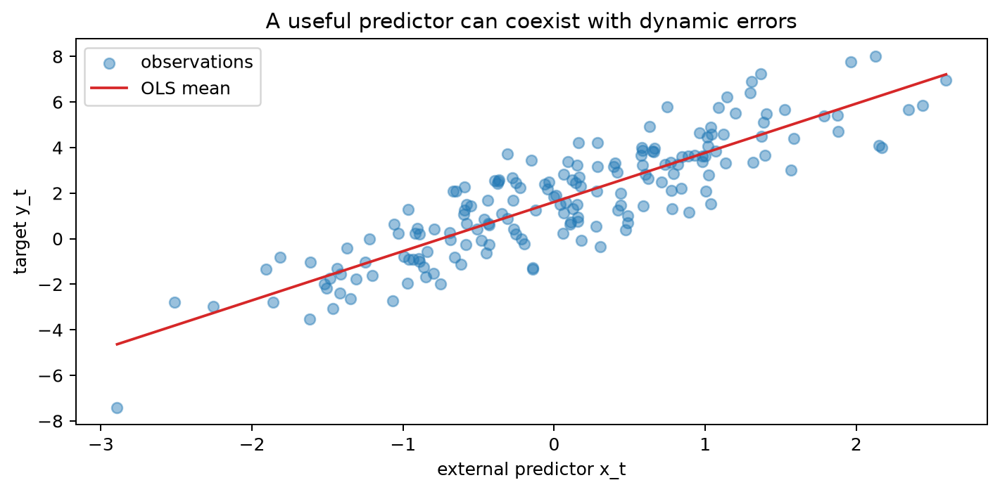
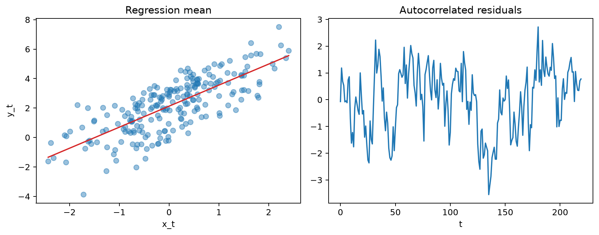

# Regression with ARMA Errors

[Time series index](README.md)

Regression with ARMA errors separates two kinds of structure that often appear together in time series. The regression component describes the relationship with observed predictors, while the ARMA component models the remaining serial error. Conditional on the complete past, the forecast combines the regression component with the predictable part of that error process.

This distinction matters for both inference and forecasting. Autocorrelated errors change the uncertainty around regression coefficients and can contain additional predictive information, so a good model must handle the mean relationship and the temporal error process as parts of one coherent specification.

**Reading guide.** Read the equation as a regression component plus an error process with its own dynamics. The numerical example then separates the serial error into its predictable part and its new innovation. Use that distinction when checking residuals: regression errors can remain correlated by design, while the fitted innovation residuals are the quantities expected to resemble white noise.

**Related reading:** [dynamic regression](dynamic_regression.md).

## Formula reference

| Component / case | General formula | Notes / special case |
|---|---|---|
| Regression with dynamic errors | $y_t=x_t^\top\beta+n_t$ | The regression component describes predictor effects; forecasting also uses the predictable part of $n_t$. |
| ARMA($p,q$) errors | $\phi(B)n_t=\theta(B)\varepsilon_t$ | $\varepsilon_t$ is white noise; MA sign convention can vary. |
| Combined model | $\phi(B)(y_t-x_t^\top\beta)=\theta(B)\varepsilon_t$ | Compact regression-with-ARMA-errors form. |
| AR(1) errors | $n_t=\rho n_{t-1}+\varepsilon_t$ | Stationary when $\lvert\rho\rvert<1$. |
| AR(1) quasi-difference | $y_t-\rho y_{t-1}=\beta_0(1-\rho)+\beta^\top(x_t-\rho x_{t-1})+\varepsilon_t$ | Basis of GLS-style transformations for AR(1) errors. |
| GLS estimator | $\hat\beta=(X^\top\Sigma^{-1}X)^{-1}X^\top\Sigma^{-1}y$ | Uses the error covariance matrix $\Sigma$. |
| Error covariance, stationary AR(1) | $\mathrm{Cov}(n_t,n_{t-h})=\sigma_n^2\rho^{\lvert h\rvert}$ | $\sigma_n^2=\sigma_\varepsilon^2/(1-\rho^2)$. |
| One-step forecast | $\hat y_{t+1\mid t}=x_{t+1}^\top\hat\beta+\hat n_{t+1\mid t}$ | Requires the future predictor vector $x_{t+1}$. |
| Regression with ARIMA errors | $\phi(B)(1-B)^d n_t=\theta(B)\varepsilon_t$ | Allows nonstationary error structure before differencing. |
| Dynamic-regression difference form | $\phi(B)(1-B)^d(y_t-x_t^\top\beta)=\theta(B)\varepsilon_t$ | Common ARIMAX/regression-with-ARIMA-errors representation. |

## Worked calculation: a regression mean plus serial error

Consider

$$
y_t=1+2x_t+n_t,
\qquad
n_t=0.7n_{t-1}+\varepsilon_t.
$$

If $x_t=3$ and the current error happens to be $n_t=0.4$, then

$$
y_t=1+2(3)+0.4=7.4.
$$

The regression mean is $1+2(3)=7$, but the error is serially dependent. Under suitable exogeneity, ordinary least squares can still estimate the mean coefficients consistently, but the usual independent-error standard errors and forecast formulas are no longer appropriate. Modeling the ARMA error captures the predictable part of $n_t$ and produces uncertainty estimates that reflect the temporal dependence.

The figure separates the regression mean from the serial error around it. The covariates explain the systematic mean structure, while the ARMA component describes dependence that remains after conditioning on those predictors.

## Model equation and the two error sequences

In many applications, the response $y_t$ depends on observed covariates and still has autocorrelated residual variation. A **regression with ARMA errors** writes

$$
y_t=x_t^\top\beta+n_t,
$$

where the error process follows an ARMA model such as

$$
n_t=\phi_1n_{t-1}+\cdots+\phi_pn_{t-p}
+\varepsilon_t-\theta_1\varepsilon_{t-1}-\cdots-\theta_q\varepsilon_{t-q}.
$$

Here $\varepsilon_t$ is white noise. The signs on the MA coefficients are a convention; some texts and software use plus signs instead, so compare full model equations rather than parameter labels alone.

## Why This Matters

Serially correlated errors affect both inference and forecasting. Even when the regression coefficients remain consistently estimable under appropriate exogeneity assumptions, the ordinary independent-error covariance formula is generally wrong. Ignoring residual dependence can therefore produce misleading standard errors, confidence intervals, and tests.

A fitted error process also improves dynamic forecasts because part of the current residual may be predictable from previous residuals. This is different from merely adjusting standard errors after fitting the mean model.

## Practical Workflow

A practical workflow is:

1. align the response and predictors and specify the regression mean;
2. inspect residual ACF/PACF and plots after fitting a simple mean model;
3. choose a parsimonious ARMA structure for the remaining serial dependence;
4. estimate the regression coefficients and error process together, commonly by maximum likelihood or generalized least squares methods;
5. check that the final standardized innovation residuals no longer contain systematic autocorrelation;
6. evaluate forecasts using only predictors and observations available at each forecast origin.

This structure combines explanatory regression with a time-series model for the unexplained dynamics.

## Worked examples: estimating the mean and error process

Write

$$
y_t=x_t^\top\beta+n_t,
\qquad
\phi(B)n_t=\theta(B)\varepsilon_t.
$$

The regression component $x_t^\top\beta$ describes the predictor relationship. The regression error $n_t$ can still be forecast from its own history, so the full conditional mean also includes $E(n_t\mid\mathcal F_{t-1})$ when the required predictors are available. The innovation $\varepsilon_t$ is the new shock after that dynamic prediction. Keeping those roles separate helps avoid using lagged error structure to compensate for a missing predictor or trend.

### Numerical example

Suppose

$$
y_t=1+2x_t+n_t,
\qquad
n_t=0.7n_{t-1}+\varepsilon_t.
$$

For $x_t=3$ and $n_t=0.4$,

$$
y_t=1+2(3)+0.4=7.4.
$$

The regression mean is 7. If $n_{t-1}=0.5$, the predictable AR contribution to the current error is

$$
0.7(0.5)=0.35,
$$

so the innovation is

$$
\varepsilon_t=0.4-0.35=0.05.
$$

This decomposition shows how the observed value can depart from the regression mean in a way that is partly predictable from earlier errors and partly new information.

### Why ordinary least squares can mislead

Under suitable exogeneity, OLS can estimate $\beta$ consistently even when the errors are autocorrelated. Its usual independent-error variance estimator, however, is generally invalid, and OLS is no longer efficient among linear unbiased estimators when the covariance structure is known.

A heteroskedasticity-and-autocorrelation robust covariance estimator can improve inference about $\beta$ without specifying a full dynamic error model. It does not, by itself, model the serial errors or provide the same recursive forecasts. Choose between these approaches according to the inferential or forecasting objective.

### GLS intuition

If the error covariance matrix $\Sigma$ were known, generalized least squares would estimate

$$
\hat\beta_{\mathrm{GLS}}
=(X^\top\Sigma^{-1}X)^{-1}X^\top\Sigma^{-1}y.
$$

The transformation accounts for the fact that observations with correlated errors contain overlapping information. In practice, $\Sigma$ is unknown and must be estimated from the ARMA parameters, often jointly or iteratively. Misspecifying the error model can therefore affect both coefficient uncertainty and forecasts.

The figure illustrates this joint view: the regression component follows the predictor-driven mean, while the dynamic error model accounts for systematic departures around it.

### Workflow

1. Align the response and predictors on the correct timestamps.
2. Fit a simple, interpretable mean model.
3. Inspect residual ACF/PACF and squared residuals.
4. Choose a parsimonious error structure.
5. Estimate the combined model.
6. Check standardized residuals and parameter stability.
7. Backtest predictions using only information available at each forecast origin.

See [dynamic regression](dynamic_regression.md) for predictor availability, lagged effects, and forecast scenarios for future covariates.
