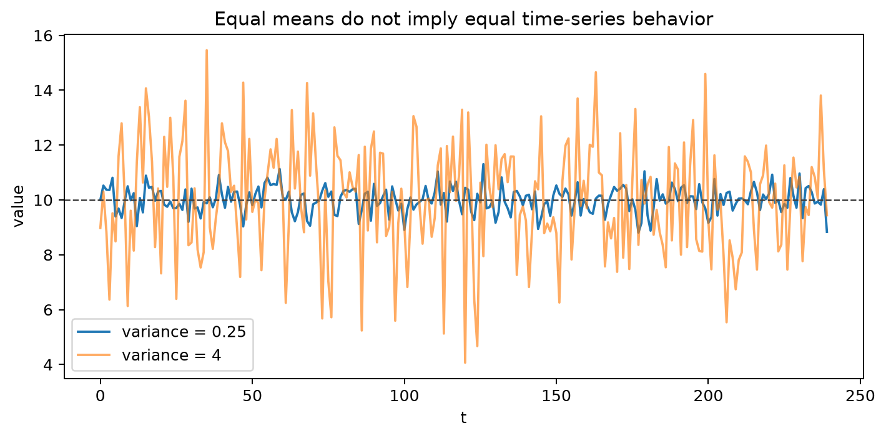
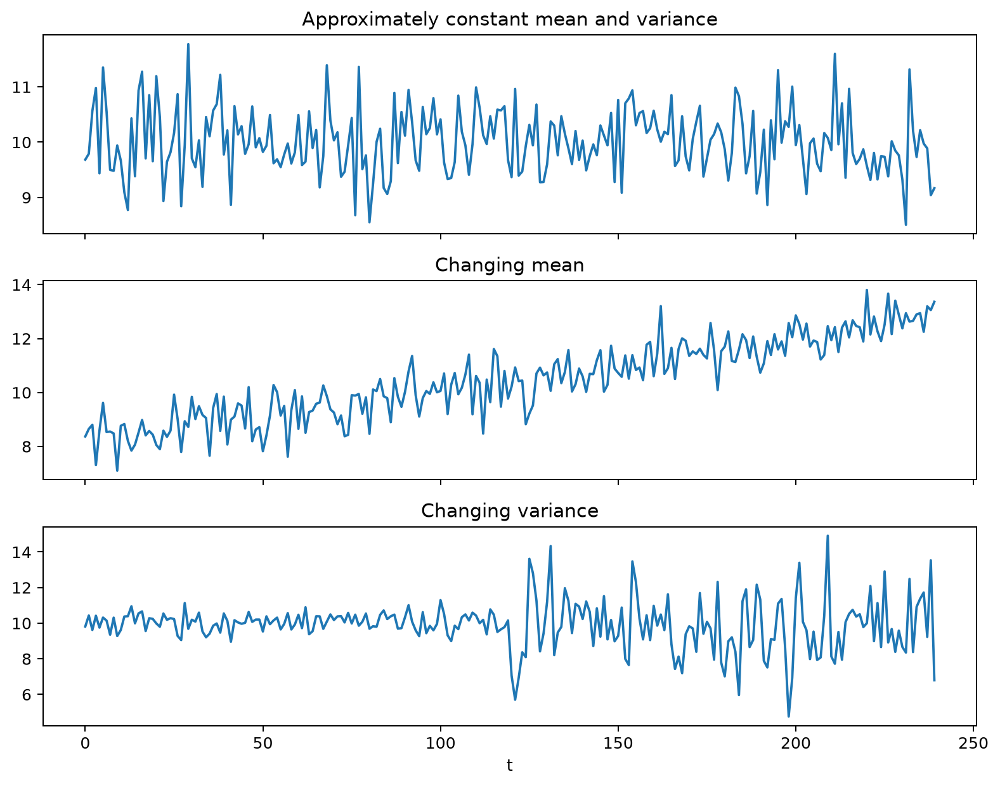

# Statistical Moments and Time Series

[Time series index](README.md)

Statistical moments summarize features such as the center, spread, and joint variation of a distribution. In time series, those same quantities acquire a time dimension: the mean and variance may change across the record, and covariance becomes a function of lag as well as scale.

This makes moment calculations more than descriptive summaries. Stable moments support stationary modeling, while changing means, variances, or lag relationships point to trend, volatility, structural change, or other dynamics that must be represented before a simple stationary model is appropriate.

**Reading guide.** Read the mean and variance examples as descriptions of distributions at particular times, then examine how lagged products add information about ordering. The numerical examples deliberately reuse a few observations so that changes in the denominator or observation order can be checked by hand. Rolling summaries are exploratory estimates; they are not the population moment functions themselves.

**Related reading:** [autocovariance](autocovariance_function.md).

## Formula reference

| Moment / summary | General formula | Time-series interpretation |
|---|---|---|
| Raw $k$th moment | $m_k=E[X^k]$ | Describes the marginal distribution at a fixed time. |
| Central $k$th moment | $\mu_k=E[(X-E[X])^k]$ | $\mu_2$ is variance; higher moments describe shape. |
| Mean function | $\mu_t=E[X_t]$ | Constant in $t$ under weak stationarity. |
| Variance | $\mathrm{Var}(X_t)=E[(X_t-\mu_t)^2]$ | Constant in $t$ under weak stationarity. |
| Standard deviation | $\sigma_t=\sqrt{\mathrm{Var}(X_t)}$ | Expresses spread in the original units. |
| Skewness | $\gamma_1=E[(X-\mu)^3]/\sigma^3$ | Measures asymmetry of the marginal distribution. |
| Kurtosis | $\gamma_2=E[(X-\mu)^4]/\sigma^4$ | Normal distribution has kurtosis $3$; excess kurtosis subtracts $3$. |
| Autocovariance | $\gamma_t(h)=\mathrm{Cov}(X_t,X_{t-h})$ | Under weak stationarity, write $\gamma(h)$ because it depends only on lag. |
| Autocorrelation | $\rho(h)=\gamma(h)/\gamma(0)$ | Scale-free lag dependence. |
| Cross-covariance | $\gamma_{XY}(h)=\mathrm{Cov}(X_t,Y_{t-h})$ | Describes lead-lag linear association between two series. |
| Sample mean | $\bar x=n^{-1}\sum_{t=1}^{n}x_t$ | Global level estimate when one mean is meaningful. |
| Sample variance with divisor $n-1$ | $s^2=(n-1)^{-1}\sum_{t=1}^{n}(x_t-\bar x)^2$ | Unbiased for IID observations with finite variance; serial dependence changes that conclusion. |
| Rolling mean | $\hat\mu_t^{(w)}=w^{-1}\sum_{j=0}^{w-1}x_{t-j}$ | Local level over a window of width $w$. |
| Rolling variance | $\hat v_t^{(w)}=(w-1)^{-1}\sum_{j=0}^{w-1}(x_{t-j}-\hat\mu_t^{(w)})^2$ | Local spread over the same window. |

## Worked calculation: mean, variance, and lag covariance

For the four observations

$$
2,\quad4,\quad4,\quad6,
$$

the sample mean is

$$
\bar x=\frac{2+4+4+6}{4}=4.
$$

The empirical variance with divisor $n=4$ is

$$
\frac{(-2)^2+0^2+0^2+2^2}{4}=2,
$$

Using the divisor $n-1=3$ instead gives $8/3\approx2.667$. This familiar correction is unbiased for IID observations with finite variance. For serially correlated observations, dividing by $n-1$ does not generally remove the bias, because the sample mean and the squared deviations also depend on the serial covariance structure.

At lag 1, the paired centered products are

$$
(-2)(0)+(0)(0)+(0)(2)=0.
$$

Thus this small sample has lag-1 covariance zero, even though zero sample covariance does not imply independence. In a time series, moments must be considered together with their time and lag structure, so a single overall mean or variance can be misleading when those quantities change over time.

The figure illustrates why the mean alone is not enough to describe a series: two sequences can be centered at similar levels while differing substantially in their spread.

Statistical moments summarize important features of a distribution. In time-series analysis, the same ideas are useful, but they must be interpreted with an additional question: do those features remain stable over time? A changing mean, variance, or dependence structure can be as important as the numerical value of the moment itself.

## Introduction to Statistical Moments in Time Series

The **mean** describes the central level of a process, while the **variance** measures the average squared deviation around that level. The standard deviation is the square root of the variance and expresses spread in the original units of the data.

For a time series, these summaries may vary with time. A rising mean can indicate a trend, while a changing variance can indicate periods of greater or lower volatility. The next examples separate these two effects visually.

## Examples of Time Series with Varying Statistical Moments

Consider first a series whose location changes while its spread stays roughly stable, then a series whose spread changes while its central level remains similar.

### Time Series with a Varying Mean

In this example, the center of the series increases over time while the dispersion around that center remains relatively stable. The visual pattern suggests investigating a changing mean or level. A deterministic trend changes the population mean directly; a zero-drift random walk instead has a constant population mean but a wandering realized level and growing variance. A single path can suggest either mechanism, so its appearance alone does not distinguish them.

### Time Series with a Varying Standard Deviation

Here the central level is comparatively stable, but the amplitude of the fluctuations changes over time. This is a changing-variance pattern. Financial returns often show similar volatility clustering, with quiet periods followed by periods of larger movements.

The two figures demonstrate why stationarity involves more than checking whether a plot has an obvious trend. Both the level and the variance structure matter.

This companion figure places the cases side by side so that changes in the mean and changes in the variance can be distinguished directly.

## Time Series vs. Independent Random Variables

A time series differs from an unordered sample because the observation order can carry information. Two datasets can have the same marginal distribution, mean, and variance while having very different temporal dependence.

The following visualization compares an observed sequence with a fitted marginal distribution.

The time-series plot preserves the ordering of observations, while the fitted distribution summarizes only their marginal values. Independent draws from that fitted distribution reproduce the histogram in expectation, but they do not reproduce any serial dependence that may be present in the original sequence.

A time index does not itself imply dependence: independent noise is also a time series. Weak white noise has zero autocorrelation but can still have nonlinear dependence. Time-series analysis therefore examines the type of dependence supported by the data instead of inferring independence from a flat sample ACF.

## Implications for Modeling and Analysis

Recognizing temporal dependence is important for estimation, uncertainty quantification, and forecasting. Methods designed for independent observations can give misleading standard errors or forecasts when serial structure is ignored.

An **autoregressive (AR)** model represents dependence on past values of the series. A **moving average (MA)** model represents dependence on current and past innovations. An **ARMA** model combines both structures when neither component alone gives an adequate description. These models do not automatically represent trends or seasonality; those features must be handled explicitly when present.

The ACF, PACF, residual diagnostics, and out-of-sample forecasts help determine whether a proposed dependence structure is useful.

## Worked examples: moments, ordering, and rolling estimates

For a cross-sectional sample, one mean and one variance may summarize the marginal distribution. For a time series, the relevant quantities include

$$
\mu_t=E(X_t),
\qquad
\gamma_t(0)=\mathrm{Var}(X_t),
\qquad
\gamma_t(h)=\mathrm{Cov}(X_t,X_{t-h}).
$$

Under weak stationarity, $\mu_t$ and $\gamma_t(0)$ do not depend on $t$, and $\gamma_t(h)$ depends only on the lag $h$. A changing mean or variance makes a single overall summary potentially misleading.

### Numerical moment calculation

For $(2,4,4,6)$,

$$
\bar x=4,
\qquad
\hat\sigma_n^2=\frac{(-2)^2+0^2+0^2+2^2}{4}=2.
$$

The sample variance using divisor $n-1$, which is unbiased under the IID assumptions described above, is

$$
s^2=\frac{8}{3}\approx2.667.
$$

At lag 1, the centered products are $0$, $0$, and $0$ for this ordering, so the lag-1 sample covariance is zero. This small example shows why a single zero covariance is weak evidence about the underlying process.

For the sequence $(1,2,4,3)$, the centered values are $(-1.5,-0.5,1.5,0.5)$ and the lag-1 covariance using denominator $n$ is $0.1875$.

Reorder the same values as $(1,2,3,4)$. The centered values become $(-1.5,-0.5,0.5,1.5)$, and the lag-1 covariance is $1.25/4=0.3125$. The marginal mean and variance have not changed, but the lag covariance has: it uses adjacent pairs, so it retains information about temporal order.

### Cross-moments and dependence

For two series $X_t$ and $Y_t$, the lagged cross-covariance is

$$
\gamma_{XY}(h)=\mathrm{Cov}(X_t,Y_{t-h}).
$$

It can reveal lead-lag association, but it is sensitive to trend, scale, common seasonality, and the sign convention used for the lag. A peak does not establish causality. Transform or detrend only when the modeling question supports it, and interpret any lead-lag pattern in the context of when predictors are actually available.

### Rolling moments

A rolling mean and variance provide local descriptive summaries:

$$
\hat\mu_t^{(w)}=\frac1w\sum_{j=0}^{w-1}x_{t-j},
\qquad
\hat v_t^{(w)}=\frac1{w-1}\sum_{j=0}^{w-1}(x_{t-j}-\hat\mu_t^{(w)})^2.
$$

The window size $w$ trades temporal resolution against sampling noise. Short windows react quickly but fluctuate more; long windows are smoother but can hide abrupt changes. Use the same window when making direct comparisons.

### Moments do not identify a distribution

Two series can have the same mean and variance but different tails, skewness, autocorrelation, conditional variance, and structural breaks. Conversely, a time series can have a stable marginal histogram while its dependence changes over time.

Moments are therefore part of the description rather than a complete model. Plot how they evolve and examine temporal dependence separately before deciding whether a stationary model is appropriate.

### Visual companion

The changing-moments figure above summarizes the main visual lesson of this chapter: inspect the center and spread separately, then relate any changes to the dependence structure and modeling assumptions.
