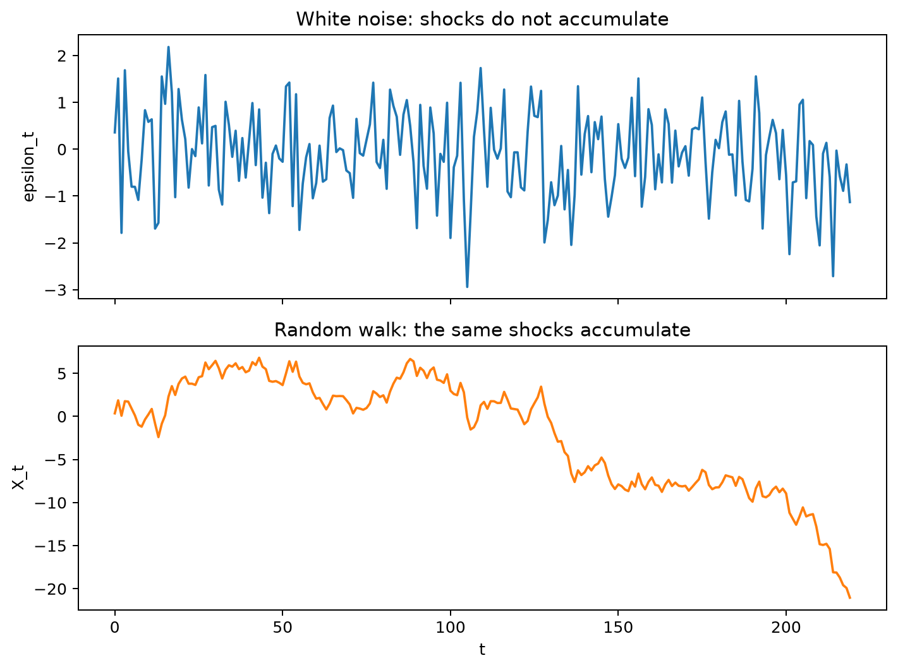

# Stochastic Processes and White Noise

[Time series index](README.md)

A stochastic process is a collection of random variables indexed by time, and an observed time series is one realized path from that process. This viewpoint separates the data we actually see from the probabilistic mechanism used to describe possible paths and future uncertainty.

White noise is the basic reference process for new, unstructured shocks. It has stable second-order behavior and no linear serial correlation, so many time-series models aim to explain the predictable structure in the data and leave behind innovations that behave approximately like white noise.

**Reading guide.** First distinguish a random variable from one observed value and a process from one observed path. Next compare white noise, independent shocks, and martingale differences by the assumptions each one adds. The worked examples return to these definitions to show why zero autocorrelation can coexist with dependence and why accumulated white-noise shocks produce a nonstationary level.

**Related reading:** [stationarity](stationarity.md).

## Formula reference

| Concept | General formula | Interpretation / special case |
|---|---|---|
| Stochastic process | $\{X_t:t\in T\}$ | A time series $x_1,\ldots,x_n$ is one realized sample path. |
| Mean function | $\mu_t=E[X_t]$ | Weak stationarity requires $\mu_t$ to be constant. |
| Covariance function | $\gamma(t,s)=\mathrm{Cov}(X_t,X_s)$ | Under weak stationarity, it depends only on $t-s$. |
| Innovation | $\varepsilon_t=X_t-E(X_t\mid\mathcal F_{t-1})$ | Then $E(\varepsilon_t\mid\mathcal F_{t-1})=0$. |
| Weak white noise | $E\varepsilon_t=0$, $\mathrm{Var}(\varepsilon_t)=\sigma^2$, $\mathrm{Cov}(\varepsilon_t,\varepsilon_{t-h})=0$ for $h\ne0$ | Zero serial covariance does not imply independence. |
| Gaussian white noise | $\varepsilon_t\stackrel{iid}{\sim}N(0,\sigma^2)$ | Common stronger assumption used for likelihoods and intervals. |
| Linear process | $X_t=\mu+\sum_{j=0}^{\infty}\psi_j\varepsilon_{t-j}$ | A broad representation for stationary linear time series. |
| Linear-process variance | $\mathrm{Var}(X_t)=\sigma_\varepsilon^2\sum_{j=0}^{\infty}\psi_j^2$ | Holds for uncorrelated innovations when the squared weights are summable. |
| Random walk | $X_t=X_{t-1}+\varepsilon_t=X_0+\sum_{j=1}^{t}\varepsilon_j$ | First difference is white noise: $\Delta X_t=\varepsilon_t$. |
| Random-walk variance | $\mathrm{Var}(X_t\mid X_0)=t\sigma^2$ | Shows why the level is not weakly stationary. |
| Martingale difference | $E(\varepsilon_t\mid\mathcal F_{t-1})=0$ | Rules out predictable conditional-mean structure. |

## Worked calculation: shocks versus accumulated shocks

Let $\varepsilon_t$ be independent with mean 0 and variance 1. It is white noise because

$$
\mathrm{Cov}(\varepsilon_t,\varepsilon_{t-h})=0\quad(h\ne0).
$$

Now define a random walk by $X_t=X_{t-1}+\varepsilon_t$ with fixed $X_0$. After 100 steps,

$$
X_{100}=X_0+\sum_{j=1}^{100}\varepsilon_j,
\qquad
\mathrm{Var}(X_{100})=100.
$$

The individual shocks have constant variance, but the variance of their accumulated sum grows with time. This is the simplest calculation showing why white-noise increments do not make the random-walk level stationary.

The figure contrasts the stable spread of the shocks with the increasing dispersion of their cumulative sum. The visual distinction mirrors the variance calculation above.

## Processes, random variables, and observed paths

A time series is one observed path from an underlying **stochastic process**: a family of random variables indexed by time,

$$
\{X_t:t\in T\}.
$$

For a fixed time $t$, $X_t$ is a random variable. After observation, its realized value is written $x_t$. The sequence $x_1,\ldots,x_n$ is one **sample path**, or realization, of the process.

## Innovations

Many time-series models separate each observation into a predictable component and a new shock:

$$
X_t=m_t+\varepsilon_t.
$$

When $m_t=E(X_t\mid\mathcal F_{t-1})$, the predictable term is the conditional mean given the available past, and $\varepsilon_t$ is a **conditional-mean innovation**. In a linear prediction model, an innovation can instead mean the error of the best linear predictor. That error is orthogonal to past linear predictors; a zero conditional mean requires an additional assumption, such as joint Gaussianity or an explicit conditional-mean model.

This distinction matters because a useful model should explain the predictable structure and leave an innovation that cannot be systematically forecast from the past.

## White Noise

A weak white-noise process $\{\varepsilon_t\}$ satisfies

$$
E[\varepsilon_t]=0,
\qquad
\mathrm{Var}(\varepsilon_t)=\sigma^2,
\qquad
\mathrm{Cov}(\varepsilon_t,\varepsilon_{t-h})=0\quad(h\ne0).
$$

The definition therefore combines a constant mean and variance with the absence of linear serial correlation. It does not require independence. **Independent white noise** adds independence across time, while **Gaussian white noise** is commonly taken to mean independent normal innovations with constant variance.

For a fitted time-series model, residuals that resemble white noise indicate that the model has removed the systematic linear dependence it was designed to explain. That is a necessary diagnostic for many models, but not a guarantee that every aspect of the data-generating process has been captured.

## White Noise vs Random Walk

White noise is weakly stationary, while a random walk accumulates white-noise shocks:

$$
X_t=X_{t-1}+\varepsilon_t
=X_0+\sum_{j=1}^{t}\varepsilon_j.
$$

Because the variance of the level grows with $t$, the random walk is not weakly stationary even though its first differences are white noise. The worked calculation and figure at the start of the chapter show this contrast directly.

## Martingale Differences

If $\mathcal F_{t-1}$ represents the information available before time $t$, a martingale difference satisfies

$$
E[\varepsilon_t\mid\mathcal F_{t-1}]=0.
$$

This condition rules out predictable conditional-mean structure. Weak white noise, by contrast, only rules out linear autocorrelation in the unconditional second moments. With finite second moments, a martingale difference is uncorrelated with its own past, but its unconditional variance need not be constant. A martingale difference with constant variance is therefore weak white noise. Weak white noise does not, in the other direction, guarantee a zero conditional mean or independence.

## Worked examples: paths, innovations, and dependence

The notation $X_t$ and $x_t$ keeps two ideas separate:

- $X_t$ is a random variable before the observation is made;
- $x_t$ is the realized value in one sample path.

A stochastic process is a collection of random variables indexed by time. A dataset gives one path, not every possible path. The model describes a distribution over paths and uses the observed path to infer the underlying mechanism and future uncertainty.

### Filtrations and predictable information

Let $\mathcal F_t$ contain the observations and predictors available through time $t$. A one-step innovation is the unpredictable part of the next observation:

$$
\varepsilon_{t+1}=X_{t+1}-E(X_{t+1}\mid\mathcal F_t).
$$

By construction,

$$
E(\varepsilon_{t+1}\mid\mathcal F_t)=0.
$$

This conditional statement is stronger and more targeted than merely finding a small unconditional sample autocorrelation. A process can have zero linear autocorrelation while its conditional variance or another nonlinear feature still depends on the past.

### White noise conditions

Weak white noise requires

$$
E(\varepsilon_t)=0,\qquad
\mathrm{Var}(\varepsilon_t)=\sigma^2,\qquad
\gamma(h)=0\quad(h\ne0).
$$

Several related terms are used in practice:

| term | additional property |
|---|---|
| weak white noise | constant mean and variance, with zero autocovariances at nonzero lags |
| independent white noise | observations are independent across time |
| Gaussian white noise | usually independent normal observations with constant variance |
| martingale difference | conditional mean is zero given the past |

These concepts overlap, but they are not interchangeable. State which assumption is being used before drawing conclusions from it.

### A dependence counterexample

Let $Z_t$ be IID standard-normal random variables, and define

$$
X_t=Z_tZ_{t-1}.
$$

The mean is zero and the variance is 1. At lag 1, independence of the $Z$ variables gives $\mathrm{Cov}(X_t,X_{t-1})=E[Z_tZ_{t-1}^2Z_{t-2}]=0$; every other nonzero lag also has zero covariance. Thus $X_t$ is weak white noise.

Adjacent values nevertheless share a random factor. For this normal example, $E(X_t^2X_{t-1}^2)=E(Z_t^2)E(Z_{t-1}^4)E(Z_{t-2}^2)=3$, while $E(X_t^2)E(X_{t-1}^2)=1$. The squared values therefore have covariance 2 and are dependent. Zero autocorrelation of the original series has left this dependence undetected.

### White noise and random walk

If $\varepsilon_t$ has variance $\sigma^2$ and

$$
X_t=X_0+\sum_{j=1}^{t}\varepsilon_j,
$$

then, for fixed $X_0$ and independent increments,

$$
\mathrm{Var}(X_t\mid X_0)=t\sigma^2.
$$

With $\sigma^2=4$, the conditional variance after 25 steps is $100$. The increments retain the same variance at every time point, but uncertainty about the level accumulates from one step to the next.

### Residual use

Innovation residuals that resemble white noise are a useful target when checking a conditional-mean model. Regression errors and fitted innovations need not be the same sequence, so identify the residual type before interpreting a diagnostic. If residuals retain autocorrelation, some predictable mean structure remains. If squared residuals retain autocorrelation, the conditional variance may still be time-varying. Heavy-tailed residuals can also make Gaussian prediction intervals too narrow.

These diagnostics provide evidence rather than proof. A finite sample can look white by chance, and standard autocorrelation tests have limited power against nonlinear or time-varying alternatives.

Continue with [stationarity](stationarity.md), [autocovariance](autocovariance_function.md), and [autocorrelation](autocorrelation_function.md) to see how these ideas are used in time-series modeling and diagnostics.
